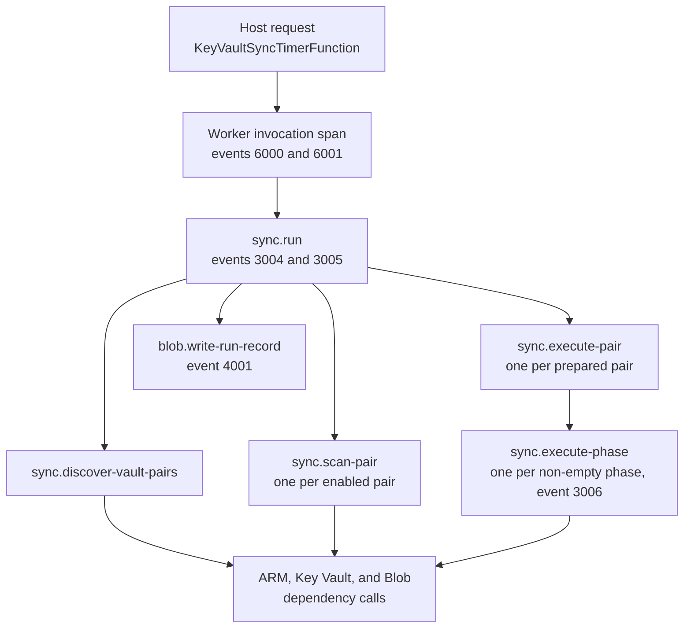

# KeyVaultSync Observability

KeyVaultSync emits structured logs, W3C activities, Azure SDK dependencies, low-cardinality metrics, and durable private run reports.

## Tracking an Invocation

Each timer invocation writes one start record (`6000`) and exactly one completion record (`6001`). Start from the completion record: it states the invocation outcome, the aggregate run status, value-free counts, and the location of the run's durable JSON record.

Because `host.json` sets `telemetryMode` to `OpenTelemetry`, the portal's **Function Invocations** page and log streaming do not show these traces. Use Application Insights **Transaction search**, its end-to-end transaction view, or the [invocation queries](#querying-invocations-and-runs).

### Correlation Keys

Every record from one invocation can be grouped by these keys:

| Key | Present on | Groups |
|---|---|---|
| `OperationId` | Every request, dependency, trace, and exception row of the invocation; `traceId` in the run record | The complete invocation: host request, worker, runner, and Azure SDK calls |
| `FunctionInvocationId`, `FunctionName` | Logger scope on every log written during the invocation | Worker logs for the host-assigned invocation ID |
| `RunId` | Logger scope from run start; `sync.run_id` span tag; `runId` in the run record | One synchronization cycle |
| `RunRecordContainer`, `RunRecordBlobName` | Logger scope from run start; `sync.run_record.*` span tags | The cycle's durable JSON record |
| `SourceVaultName`, `SourceResourceGroup`, `SourceSubscriptionId`, matching `Target*` properties, `PairNumber` | Logger scope during pair scanning, execution, and lease release; the full `{sourceId}=>{targetId}` identity stays in the `sync.pair_id` span tag and the run record | One source/target pair |
| `ExecutionPhase` | Logger scope and `sync.phase` span tag during an execution phase | One ordered execution phase of one pair |

### Span Hierarchy



`sync.run` is an internal span, so the host request remains the only request row; the run, pair, and phase spans appear as in-process dependency rows. A phase span's display name includes its phase, such as `sync.execute-phase ObjectCreateReconcile`.

### Invocation and Run Events

| Event ID | Event name | Level | Records |
|---:|---|---|---|
| `6000` | `TimerInvocationStarted` | Information; Warning when past due | Invocation ID, function name, app version, past-due flag, schedule, and timer-monitor timestamps |
| `6001` | `TimerInvocationCompleted` | By outcome, below | Outcome, duration, RunId, run status, discovery/pair/plan counts, verified object and RBAC changes, and run-record URI; the exception type when the runner raised |
| `3004` | `RunStarted` | Information | RunId, mode, subscription count, trace ID, and run-record URI |
| `3005` | `RunCompleted` | Information; Warning; Critical for `Failed` | Duration, discovery and pair counts, pair-status distribution, plan and verified-change counts, and run-record URI |
| `3006` | `ExecutionPhaseCompleted` | Information; Warning when items need attention or the phase was cancelled; Error when it failed | Per-pair phase outcome, duration, and item, verified-change, no-change, and attention counts |
| `4001` | `RunRecordPersisted` | Information | Each run-record snapshot write, with its container and blob name |

### Invocation Outcomes

| Runner result | `InvocationOutcome` | `6001` level | Invocation |
|---|---|---|---|
| `Complete` or `NoConfiguredPairs` | `Succeeded` | Information | Succeeds |
| `Partial` or any other status | `CompletedWithWarnings` | Warning | Succeeds; review the run record |
| `Failed` | `Failed` | Critical | Fails with the RunId and run-record URI in the error |
| `Cancelled` | `Cancelled` | Warning | Fails as cancelled |
| Runner exception | `Failed` | Error, with the exception attached | The original exception propagates |
| Host cancellation | `Cancelled` | Warning, without an exception | Cancellation propagates |

An exception raised after the run started carries its RunId, status, and run-record location, so its `6001` record names the run record. A failure before the run starts, such as `KVS-CONFIG-HMAC-INVALID` or `KVS-STORAGE-INITIALIZE`, ends with `No run record was created for this invocation.` A record with an attached exception is exported to `AppExceptions` instead of `AppTraces`.

### Run Record Location

The run record is `runs/<yyyy>/<MM>/<dd>/<RunId>.json` in the runs container (`keyvaultsync-runs` by default), partitioned by the run's UTC start date. Events `3004`, `3005`, and `6001` and the `sync.run_record.uri` tag carry its Blob URI without a query string, so they never contain a SAS token; reading the blob still requires Blob data-plane authorization. The record's `traceId` equals the Application Insights `OperationId` of the invocation that wrote it. See [troubleshooting](troubleshooting.md#find-an-invocations-run-record) to download one.

### Invocation Span Tags

The invocation handler adds string-valued tags to the worker invocation span: `timer.is_past_due`, `sync.invocation.outcome`, `sync.run_id`, `sync.status`, `sync.run_record.container`, `sync.run_record.blob`, `sync.run_record.uri`, the value-free `sync.pair.*`, `sync.plan.*`, `sync.object.verified_change_count`, and `sync.rbac.verified_change_count` counts, and `error.type` when the runner raised. Newer Functions host versions can copy string-valued worker tags onto the host request record, which makes them filterable on `AppRequests`. That propagation depends on the host version and has not been verified live for this repository. The `sync.run` span carries the same counts.

## Implemented Signals

Structured logs cover timer invocation start/completion, run start/completion, discovery, pair lease and planning progress, inventory stages, plan persistence, execution phases, object mutation intent and verification, RBAC execution, and pair completion. Logger scopes carry the invocation, run, pair, and phase correlation context through child services.

Administrator-facing events use stable IDs and `KVS-*` diagnostic codes:

| Event ID | Event name | Purpose |
|---:|---|---|
| `5000` | `InventoryWarning` | One value-free category for each source or target inventory warning |
| `5001` | `PlanOutcomeSummary` | Counts of blocked, conflicting, failed, or unresolved plan items grouped by status, object type, and action |
| `5002` | `RbacOutcome` | RBAC readiness, success, self-protection, validation, mutation, and verification outcomes with bounded scope kind and role ID |
| `5003` | `PairDiagnosticSummary` | Pair status and aggregate source warnings, target warnings, attention items, and failed RBAC items |
| `5004` | `DiscoveryDecision` | Every enabled, disabled, or rejected source/target mapping decision |
| `5005` | `ObjectOutcome` | Every object safety, mutation, exact-verification, conflict, and ambiguous-intent outcome |
| `5006` | `RunDiagnosticSummary` | Complete, empty, partial, cancelled, failed, or unknown terminal run classification |
| `5007` | `SystemFailure` | Bounded configuration, storage, lease, scan, execution, or orchestration failure category |
| `5008` | `LifecycleTransition` | Run, discovery, inventory, planning, and execution stage transitions for timeline reconstruction |

Planning and execution emit all current statuses, including ready/in-sync/success states, not only failures. This allows the analyzer to distinguish missing evidence from an explicitly successful check. Diagnostic properties intentionally contain bounded categories and counts. They do not contain object values, HMAC material, principal IDs, or complete ARM scopes. The exact affected vaults, objects, and plan-item details remain in the protected durable run record.

Every administrator diagnostic uses the same bounded decision fields:

- `DiagnosticCode`, `DiagnosticStage`, and `DiagnosticOutcome`;
- `EvidenceType` (`Evidence` for runtime observations);
- `AdminPriority` (`Critical`, `High`, `Medium`, or `None`);
- `ActionDecision` (`AdminReviewRequired`, `NoActionRequired`, or a lifecycle action);
- `Confidence` (`High` for cataloged outcomes and `Low` for unknown fallbacks);
- `AdminAction` for the identifier-free inferred recommendation.

Logger scopes provide the [correlation keys](#correlation-keys). Object events add `ObjectType` and `ObjectAction`; authorization events add bounded `ScopeKind` and `ObjectAction`. Raw object names, principal IDs, and complete authorization scopes are intentionally excluded from these new correlation fields. Use the protected durable record when exact subject identity is required.

W3C activities cover the run, discovery, pair scanning/execution, execution phases, ARM reads, Key Vault inventory, Blob state operations, and Azure SDK dependencies.

The `KeyVaultSync.Runner` meter emits:

- `keyvaultsync.runs.started` and `keyvaultsync.runs.completed`;
- `keyvaultsync.pairs.processed`;
- `keyvaultsync.failures`;
- `keyvaultsync.objects.inventoried`;
- `keyvaultsync.run.duration`;
- `keyvaultsync.pair.duration`.

Metric dimensions are bounded to values such as object type, vault role, mode, and status. Detailed item outcomes and reason codes remain in logs and durable reports instead of metric dimensions.

Durable private Blob reports are the authoritative record for the discovered graph, pair plans, terminal item outcomes, and unresolved mutation intent. Telemetry is an operational index, not a replacement for those records.

## Privacy

Never export:

- secret values;
- certificate PFX or private-key material;
- HMAC keys or signatures;
- credentials, tokens, or connection strings;
- JWK material;
- raw tags when their content is not controlled.

Persisted private Blob reports may contain operational identifiers needed for review. Exported telemetry must never include object values or cryptographic material. Keep metric dimensions low-cardinality and do not add names, ARM IDs, subscription IDs, or principal IDs to metrics.

Current application logs and activities can include raw operational identifiers for diagnosis, including the storage account, container, and run-record path. Run-record URIs never include a query string or SAS token. Restrict telemetry access and retention accordingly; a future keyed-correlation sanitization pass would be required before treating exported telemetry as identifier-free.

The [offline log analyzer](../tools/keyvaultsync-log-analyzer.html) redacts common ARM IDs, GUIDs, run IDs, service hosts, and labeled vault/object names by default. It visibly separates parsed evidence from inferred recommendations, derives a `Healthy`, `Needs review`, `Partial`, or `Blocked` assessment, and ranks actions from P1 through P4. `KVS-RBAC-403`, ambiguous object outcomes, unresolved intents, pair-state persistence failures, and lease-renewal failures are P1. Inventory warnings always produce at least a `Partial` assessment.

Sanitized summaries can be downloaded as JSON for automation or as a standalone HTML report. Both formats exclude the source filename and apply redaction to evidence text. This is a sharing aid, not a declassification guarantee. Review every downloaded sanitized summary before sharing it outside the authorized operational team.

The analyzer catalog covers:

- every current discovery eligibility decision;
- all inventory warning categories;
- every planner and object/RBAC executor status;
- every terminal pair and run status;
- HMAC configuration, Blob initialization/persistence, lease renewal/release, pair scan/execution, and orchestration failures;
- legacy message signatures from deployments that predate diagnostic codes.

Tests require every runtime diagnostic code to exist in the analyzer. An unknown status is elevated as `KVS-PLAN-UNKNOWN-STATUS`, `KVS-PAIR-UNKNOWN`, `KVS-RUN-UNKNOWN`, or the corresponding discovery/system fallback instead of being treated as success.

## Application Insights

IaC configures workspace-based Application Insights with managed-identity ingestion. The Function identity receives `Monitoring Metrics Publisher`; local authentication is disabled.

Recommended production controls that are not created by the current IaC:

- retention and daily-cap policy appropriate to the environment;
- alert on timer silence, such as no `6000` record within two schedule intervals;
- alert on failed/ambiguous runs, such as a `6001` record whose `InvocationOutcome` is not `Succeeded`;
- alert on unresolved intents;
- alert on an open deletion circuit breaker;
- workbook views for run health, pair health, action outcomes, and latency.

Alerts and workbooks are not a substitute for durable private reports or explicit intent-resolution tooling.

## Querying Invocations and Runs

Invocation history, one row per invocation. Add `| where InvocationOutcome != "Succeeded"` to list only invocations that need review:

```kusto
union AppTraces, AppExceptions
| where TimeGenerated > ago(7d)
| where tostring(Properties["EventId"]) == "6001"
| project TimeGenerated, OperationId,
    FunctionInvocationId = tostring(Properties["FunctionInvocationId"]),
    InvocationOutcome = tostring(Properties["InvocationOutcome"]),
    DurationMs = tolong(Properties["DurationMs"]),
    RunId = tostring(Properties["RunId"]),
    RunStatus = tostring(Properties["RunStatus"]),
    AttemptedPairs = toint(Properties["AttemptedPairCount"]),
    FailedPairs = toint(Properties["FailedPairCount"]),
    AttentionItems = toint(Properties["AttentionItemCount"]),
    VerifiedObjectChanges = toint(Properties["VerifiedObjectChangeCount"]),
    VerifiedRbacChanges = toint(Properties["VerifiedRbacChangeCount"]),
    ErrorType = tostring(Properties["ErrorType"]),
    RunRecordUri = tostring(Properties["RunRecordUri"])
| order by TimeGenerated desc
```

Complete timeline of one invocation, using an `OperationId` from the history or the run record's `traceId`:

```kusto
let operationId = "<operation-id>";
union AppRequests, AppDependencies, AppTraces, AppExceptions
| where TimeGenerated > ago(7d)
| where OperationId == operationId
| project TimeGenerated, Type, Name, Message, SeverityLevel, DurationMs, Success,
    EventName = tostring(Properties["EventName"]),
    SourceVault = tostring(Properties["SourceVaultName"]),
    TargetVault = tostring(Properties["TargetVaultName"]),
    ExecutionPhase = tostring(Properties["ExecutionPhase"]),
    DiagnosticCode = tostring(Properties["DiagnosticCode"])
| order by TimeGenerated asc
```

Execution phases of one run:

```kusto
AppTraces
| where TimeGenerated > ago(7d)
| where tostring(Properties["EventId"]) == "3006"
| where tostring(Properties["RunId"]) == "<run-id>"
| project TimeGenerated,
    SourceVault = tostring(Properties["SourceVaultName"]),
    TargetVault = tostring(Properties["TargetVaultName"]),
    ExecutionPhase = tostring(Properties["ExecutionPhase"]),
    PhaseOutcome = tostring(Properties["PhaseOutcome"]),
    DurationMs = tolong(Properties["DurationMs"]),
    Items = toint(Properties["PhaseItemCount"]),
    VerifiedChanges = toint(Properties["PhaseVerifiedChangeCount"]),
    NoChange = toint(Properties["PhaseNoChangeCount"]),
    Attention = toint(Properties["PhaseAttentionCount"]),
    ErrorType = tostring(Properties["ErrorType"])
| order by TimeGenerated asc
```

## Querying Diagnostic Codes

Use diagnostic codes rather than message text for alerts and workbooks created after this logging contract is deployed:

```kusto
AppTraces
| where TimeGenerated > ago(24h)
| extend DiagnosticCode = tostring(Properties["DiagnosticCode"])
| where DiagnosticCode startswith "KVS-"
| project TimeGenerated, SeverityLevel, DiagnosticCode,
    DiagnosticStage = tostring(Properties["DiagnosticStage"]),
    DiagnosticOutcome = tostring(Properties["DiagnosticOutcome"]),
    AdminPriority = tostring(Properties["AdminPriority"]),
    ActionDecision = tostring(Properties["ActionDecision"]),
    Confidence = tostring(Properties["Confidence"]),
    VaultRole = tostring(Properties["VaultRole"]),
    PlanStatus = tostring(Properties["PlanStatus"]),
    ScopeKind = tostring(Properties["ScopeKind"]),
    HttpStatus = toint(Properties["HttpStatus"]),
    ErrorCode = tostring(Properties["ErrorCode"]),
    AdminAction = tostring(Properties["AdminAction"])
| order by TimeGenerated desc
```

Do not add subscription IDs, vault names, object names, principal IDs, or full scopes as metric dimensions. Diagnostic codes and the fields above are intended for logs only; existing metrics remain deliberately low-cardinality.
