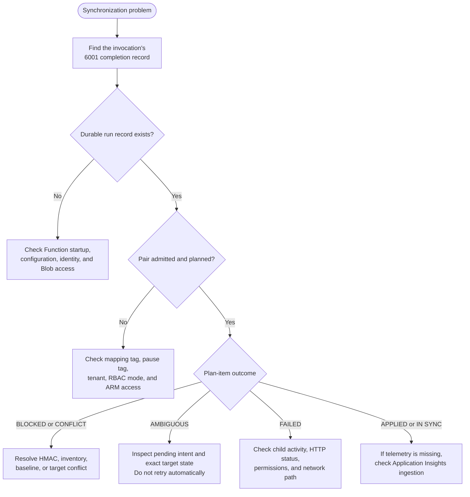

# KeyVaultSync Troubleshooting

## Fast Triage



Start with the invocation's `6001` completion record, which names the durable Blob run record, then read that record. Telemetry helps locate a failure, but it is not the authoritative mutation record.

## Find an Invocation's Run Record

1. Run the invocation history query in [observability](observability.md#querying-invocations-and-runs). Each `6001` row gives the invocation outcome, run status, `RunId`, value-free counts, and run-record URI. Rows with an attached exception are in `AppExceptions`.
2. If the row ends with `No run record was created for this invocation.`, the runner failed before the cycle started. Check the attached exception and the `KVS-CONFIG-HMAC-INVALID` or `KVS-STORAGE-INITIALIZE` diagnostic, then the Function configuration, identity, and Blob access.
3. If neither `6000` nor `6001` exists for the expected time, the invocation did not reach the runner. Check host startup, the timer schedule, runner configuration, and telemetry export.
4. Otherwise, download the record with an identity that has Blob data read access, such as `Storage Blob Data Reader`, on the runs container. The `6001` run-record URI gives the exact storage account, container, and blob name; the container is `keyvaultsync-runs` unless `KEYVAULTSYNC_RUNS_CONTAINER` overrides it:

   ```sh
   az storage blob download --auth-mode login \
     --account-name <storage-account> \
     --container-name keyvaultsync-runs \
     --name runs/<yyyy>/<MM>/<dd>/<run-id>.json \
     --file ./run-record.json
   ```

   Private network profiles also require a network path to the storage account's private endpoint.
5. To go from a run record back to telemetry, use its `traceId` as the `OperationId` in the invocation timeline query. It shows every request, span, log, and exception of the invocation that wrote the record.

The run record is private operational data. Keep downloaded copies out of tickets and source control; share the analyzer's sanitized summary instead.

## Offline Log Analyzer

Open [the self-contained KeyVaultSync log analyzer](../tools/keyvaultsync-log-analyzer.html) in a current browser and provide one of:

- a CSV export from Application Insights or Log Analytics; or
- one durable JSON run record from `keyvaultsync-runs/runs/<year>/<month>/<day>/<run-id>.json`.

The file is processed only in the browser. The page has no external scripts, upload endpoint, or network dependency. It recognizes legacy message text and the stable `KVS-*` diagnostic fields, labels parsed evidence separately from inferred remediation, and can download a sanitized incident summary as JSON or standalone HTML.

The assessment and action order are deterministic:

- `Blocked` and P1: a denied RBAC mutation, unresolved or ambiguous mutation, pair-state persistence failure, or lease-renewal failure requires investigation before another mutation attempt;
- `Partial`: any inventory warning or a partial terminal run means the run is not complete deletion evidence;
- `Needs review`: another high-priority cataloged outcome was observed;
- `Healthy`: no recognized outcome requires administrator review, but the durable record remains authoritative.

The symbols use `✓` for observed healthy/informational states, `!` for partial or review states, and `×` for blocked/high-severity states. Recommendations are explicitly labeled as inference; they do not prove effective permissions or live target state.

The public copy is published from the same tracked HTML by the `Publish log analyzer` GitHub Actions workflow:

`https://amgdy.com/keyvault-sync/`

GitHub Pages serves the HTML and JavaScript, but selected log files are still read locally by the visitor's browser and are not sent back to GitHub or another service. The analyzer rejects empty files, malformed run-record structures, malformed CSV quoting, CSVs without a supported message column, and files larger than 25 MB.

GitHub Pages is configured for this repository with **GitHub Actions** as its build source and HTTPS enforcement enabled. The workflow publishes changes to `main`; it does not require an external hosting account or repository secret.

Identifier display is disabled by default. The summary shows the run-record locator and Operation ID found in the input, redacted until identifier display is enabled. The JSON and HTML downloads omit both locators, replace the source filename, redact evidence independently of the display toggle, and preserve only bounded codes, priorities, recommendations, timestamps, and redacted evidence. The original export and run record remain private operational data, and automated redaction is not a declassification guarantee. Review the downloaded summary before sharing it.

Use CSV for a timeline and HTTP/error evidence. Use the durable JSON when you need the exact inventory warning, affected plan item, or persisted mutation outcome; those details are intentionally not duplicated into general telemetry.

## Telemetry Does Not Appear

1. Check the startup log: Azure Monitor export must be enabled.
2. Confirm `APPLICATIONINSIGHTS_CONNECTION_STRING` points to the intended workspace-based Application Insights component; never print the value into terminal logs or tickets.
3. Confirm the app identity can get an Entra token and has `Monitoring Metrics Publisher` on that component.
4. Confirm the component has ingestion enabled and that the app can reach its ingestion endpoint.
5. Query `AppRequests`, `AppDependencies`, `AppTraces`, `AppExceptions`, and `AppMetrics` in the component's linked Log Analytics workspace. Ingestion may take several minutes.
6. Do not rely on the portal's **Function Invocations** page or log streaming: neither shows invocation traces when the host uses OpenTelemetry. Query Application Insights instead.

## Missing Blob Access

- Verify `KEYVAULTSYNC_STORAGE_ACCOUNT_URI` and the selected container names.
- Confirm the runtime identity has `Storage Blob Data Owner` on the shared storage account. The role covers Function deployment/host coordination and the `keyvaultsync-state` and `keyvaultsync-runs` containers.
- If package publication cannot reach shared storage, verify both Blob authorization and network reachability. The root `predeploy` hook checks the network requirement; changing data roles does not change endpoint reachability.
- State writes require a valid pair lease and matching ETag. A lease-renewal or checkpoint failure must fail the pair and must not advance its checkpoint.
- Confirm the principal running the ARM deployment has `Owner` on the deployment resource group and `Storage Blob Data Owner` on shared storage after provisioning. Role propagation may delay Blob operations.

## Object Synchronization Is Blocked

- Confirm the pair has an enabled source/target mapping and neither vault has `KeyVaultSyncDisabled=true`.
- For certificates, confirm the source policy marks the private key exportable and the version-matched backing secret contains a valid PFX. A non-exportable certificate requires reissuance or external import into the target.
- A standalone private or symmetric key requires independent generation or external import into the target. Once a same-named target key exists, allowlisted key-scope RBAC can converge, but KeyVaultSync cannot verify private-key equivalence.
- Confirm the deployed `KEYVAULTSYNC_HMAC_KEY` came from the intended active azd environment and is the same stable Base64-encoded 32-byte key used for existing baselines. Do not print it to compare values; a different key can invalidate baseline checks. `KEYVAULTSYNC_HMAC_KEY_VERSION` is a non-secret baseline-version label, not an enable switch; do not log or copy the key into tickets or state.
- Ensure this runner is the sole writer to target objects being changed. There is no runtime single-writer acknowledgment switch or Key Vault compare-and-set write.
- A missing HMAC key blocks object writes. Run the deployment-preparation hook interactively to supply or generate the initial key, or provide it through protected pipeline configuration. Never generate a replacement for an environment with committed baselines.
- A pending intent means the previous write may have succeeded. Inspect the target's active versions and value/metadata fingerprints through the approved recovery process; never clear the intent or retry based only on timeout.
- A certificate stuck at `AMBIGUOUS_OUTCOME_UNRESOLVED_INTENT` with the detail `The exact written version did not match the expected signature` predates the deterministic certificate signature contract. Earlier builds signed the exported PKCS#12 container, which Key Vault re-encodes non-deterministically, so the post-write check could never match and no certificate baseline was ever committed. Recovery requires both steps, because the planner never adopts an existing target implicitly: clear that single pending intent, then remove the unbaselined target certificate (soft delete and purge, since a soft-deleted name reports `BLOCKED_SOFT_DELETED_TARGET` and is never purged automatically). The next run then plans a clean create and commits a verified baseline. Confirm the target thumbprint matches the source first, and perform both steps through the approved recovery process.
- An unbaselined target or unexpected target version is a conflict. Do not adopt, overwrite, or rebaseline automatically.

## Incomplete Inventory

A partial/failed scan is not deletion evidence. Check the child activity for the failing stage (secrets, keys, certificates, deleted objects, authorization, ARM discovery, or Blob state) and resolve permissions/network/timeout issues before the next complete checkpoint. Existing run history in Blob remains the durable record even when telemetry arrives late.

`KVS-INV-*` identifies the bounded warning category. `KVS-PLAN-INCOMPLETE-INVENTORY` confirms that object mutation failed closed because one or both inventories were incomplete. The exact warning text and affected object are available only in the protected durable run record.

## Role-Assignment Mutation Is Denied

`KVS-RBAC-403` means the ARM role-assignment request was denied. Successful role-assignment listing does not prove write authorization.

1. Identify the Function runtime managed identity without copying its principal ID into a public ticket.
2. Confirm it has effective **Key Vault Data Access Administrator** at the target vault or the required target child scope.
3. Allow for role-assignment propagation.
4. Check ancestor deny assignments and role-assignment conditions.
5. Review the diagnostic `ScopeKind`, `RoleDefinitionId`, `HttpStatus`, and `ErrorCode` fields and the exact private run-record item.
6. Let a later scheduled run re-plan after authorization is corrected; do not interpret a retry as proof that an earlier ambiguous mutation failed.

## A Vault Is Not Being Synchronized

Check the source and target Key Vault ARM tags for `KeyVaultSyncDisabled=true`. The tag is a deliberate pair-level opt-out and is reported in the run record as a disabled vault, not as a mapping failure. Remove the tag or change its value away from `true`, then wait for the next scheduled run. Re-enabling does not clear pending-write intents or bypass HMAC/baseline conflicts.
